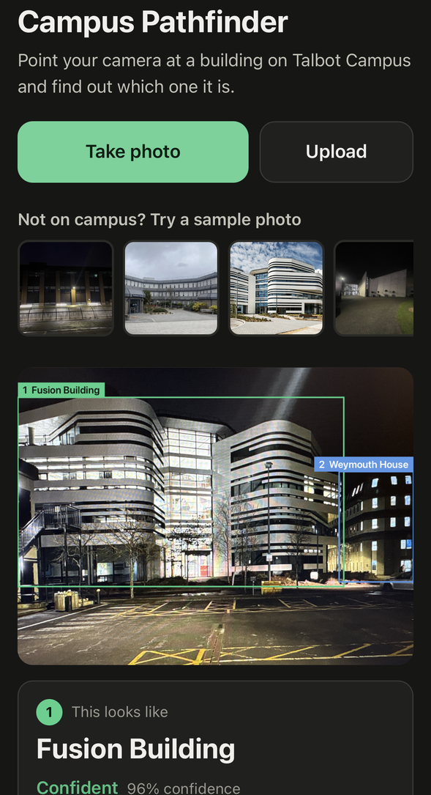
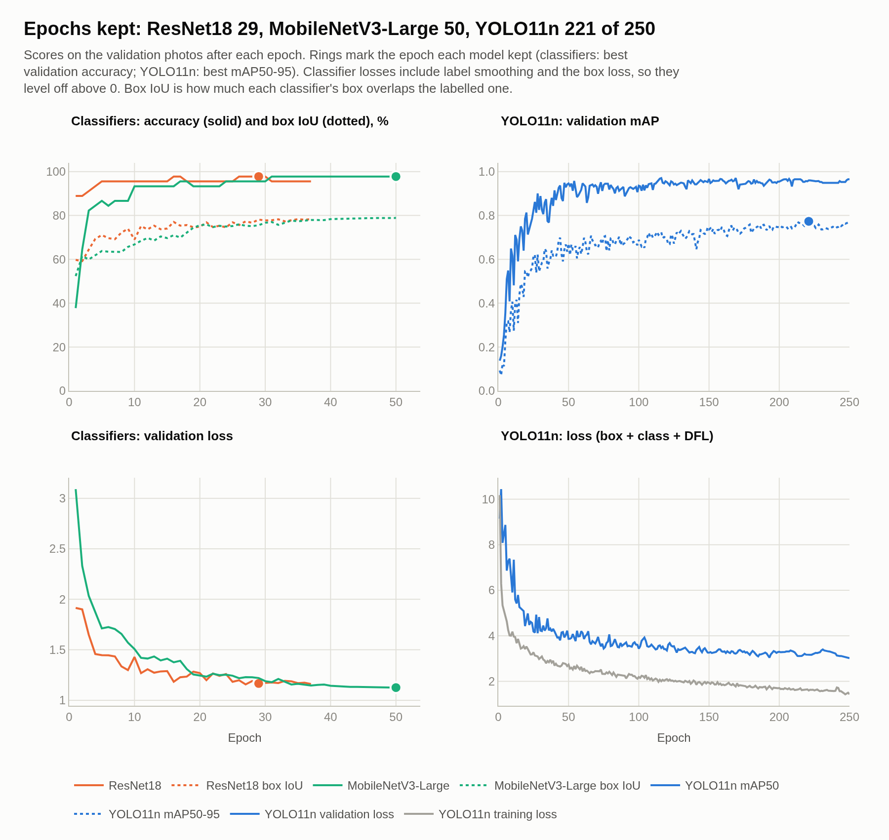

# Campus Pathfinder


[](https://colab.research.google.com/github/RollinsE/University-Pathfinder/blob/master/notebooks/colab.ipynb)

Take a photo of a building on Bournemouth University's Talbot Campus and Campus Pathfinder tells
you which one it is. It recognises eight buildings, by day and at night, and runs entirely in the
browser, so photos never leave the phone.

**Try it:** https://rollinse.github.io/University-Pathfinder/

<p align="center">
  
</p>

The repository trains and compares three models on the same photos:

- **YOLO11n**, a detector that finds and labels every building in the photo. This is what the web
  app uses.
- **ResNet18**, a baseline classifier that names the main building and draws a box round it.
- **MobileNetV3-Large**, a smaller, faster classifier that does the same.

## Results

All three models are scored on the same 21 held-out test photos. For the detector, its most
confident box counts as its answer.

| Model | Test accuracy | Box IoU | mAP50-95 | Parameters | ONNX size |
|---|---:|---:|---:|---:|---:|
| YOLO11n | 21/21 | 0.91 | 0.77 | 2.6 M | 10.7 MB |
| ResNet18 | 21/21 | 0.77 | | 11.3 M | 45.2 MB |
| MobileNetV3-Large | 21/21 | 0.79 | | 4.5 M | 18.2 MB |

With only 21 test photos, a perfect score still leaves a 95% confidence range of roughly 85–100%,
so the test set can't separate the models on accuracy. The detector is the better choice for the
app for other reasons: it draws the tightest boxes, it can name several buildings in one photo,
and it can say when it finds none. The classifiers always give exactly one answer, which works
for a photo of one building but not for a wide view of the campus.

The full table, including F1, top-3 accuracy, mAP50 and CPU time per photo, is written to
`runs/<run>/metrics/results.md` at the end of each run.

<picture>
  <source media="(prefers-color-scheme: dark)" srcset="docs/figures/training_curves_dark.png">
  
</picture>

YOLO11n kept improving slowly for most of its 250 epochs, and its validation score jumps around
from one epoch to the next because there are only 45 validation photos. That is why it trains
with a long patience (75 epochs) before early stopping.

### Known limitations

- The test set is small, so treat the scores as a rough guide rather than a precise measure.
- Photos from unusual angles, such as aerial views or buildings half hidden behind trees, are
  harder. The detector usually still finds the building but with lower confidence.
- Poole House and the Fusion Building are the pair most often confused.
- All photos come from one collection period, so new signage, scaffolding or building work may
  affect results.

## Getting started

You need Python 3.10 or later.

```bash
pip install -r requirements-dev.txt
python scripts/doctor.py        # checks your setup
python -m pytest
```

To see the whole pipeline work without an account or a GPU, run it on synthetic data. It takes a
few minutes on a laptop:

```bash
python main.py --mode all --demo
python -m http.server 8000 --directory runs/demo_webapp
```

To train on the real photos, create a free Roboflow account and put your API key in `.env` (copy
`.env.example`) or in the `ROBOFLOW_API_KEY` environment variable. Training is much faster on a
GPU.

```bash
python main.py --mode all --figures_dir docs/figures
```

### Running stages separately

Each stage can be run on its own, writing into the same run folder:

```bash
python main.py --mode acquire  --run_dir runs/run_a
python main.py --mode classify --run_dir runs/run_a
python main.py --mode detect   --run_dir runs/run_a
python main.py --mode export   --run_dir runs/run_a
python main.py --mode evaluate --run_dir runs/run_a --figures_dir docs/figures
```

| Mode | What it does |
|---|---|
| `acquire` | Downloads the dataset from Roboflow and prepares it for training |
| `classify` | Trains and tests ResNet18 and MobileNetV3-Large |
| `detect` | Trains and tests YOLO11n |
| `export` | Converts the models to ONNX, checks and times them, and builds the web app's model list |
| `evaluate` | Writes the results table and figures |
| `predict` | Runs one photo through the exported models and saves a labelled copy |
| `all` | Runs everything from `acquire` to `evaluate` |

To try a photo of your own:

```bash
python main.py --mode predict --image photo.jpg --model all
```

Run `python main.py --help` for every option. A few useful ones:

- `--workspace`, `--project` and `--version` choose the Roboflow dataset.
- `--overwrite` retrains models that already exist in the run folder.
- `--device cuda` refuses to start without a GPU, rather than quietly training on the CPU.

Interrupted training picks up from the last finished epoch when you run the same command again,
and models that have already finished are reused.

### Google Colab

[notebooks/colab.ipynb](notebooks/colab.ipynb) runs the full pipeline on a Colab GPU. Add
`ROBOFLOW_API_KEY` as a Colab secret, set the options in the first cell and choose **Run all**. It
asks you to upload the repository as a zip, runs a short smoke test, and saves everything to
Google Drive, so a dropped session can carry on where it stopped. To save compute units, you can
run the setup and download on a free CPU runtime first by setting `PREPARE_ONLY = True`.

## How it works

The eight buildings are defined once, in `src/constants.py`. When the dataset is prepared, its
labels are matched to that list by name, so every model and the web app agree on which number
means which building.

The classifiers are ImageNet-pretrained backbones with two small heads: one picks the building and
the other predicts a single box. They are trained on the building with the largest box in each
photo. YOLO11n starts from COCO weights and learns every labelled box.

All models are tested on photos they never saw during training, and those photos are not used to
choose the best checkpoint either. After export, each ONNX model is run once to check it gives
the same answers as the original and timed on a CPU.

Every run writes a single log file, `runs/<run>/logs/run.log`, and a shorter, readable version to
the console. [docs/LOGGING.md](docs/LOGGING.md) explains the format.

`--mode evaluate` also draws the figures: test accuracy, speed against download size, training
curves and a confusion matrix for each model. They're saved as interactive HTML in
`runs/<run>/plots/`, and as light and dark PNGs in `--figures_dir` if given. The PNGs need a
headless Chrome for Kaleido (`plotly_get_chrome -y`); without it you still get the HTML.

## Web app

The web app is a single static page designed for phones. You take or upload a photo, or tap one of
the samples, and it boxes and names the buildings and says in plain words how sure it is. A
comparison panel runs the same photo through all three models.

```bash
make serve    # http://localhost:8000, after running --mode export
```

[docs/WEB_APP.md](docs/WEB_APP.md) covers the design and how to publish it with GitHub Pages.

## Repository layout

```text
main.py            command-line entry point
src/               the pipeline: data, training, evaluation, export, logging
webapp/            the browser app
notebooks/         the Colab notebook (generated by scripts/build_notebook.py)
scripts/           setup check and notebook builder
tests/             Python and JavaScript tests
docs/              logging, model card, data card, web app notes, figures
```

## Data

The photos and labels are on
[Roboflow Universe](https://universe.roboflow.com/computer-vision-6ydhl/bu-building-dectection).
They are downloaded when needed and never committed to this repository. See
[docs/DATA_CARD.md](docs/DATA_CARD.md) for the dataset and
[docs/MODEL_CARD.md](docs/MODEL_CARD.md) for how the models were trained and tested.

## Credits

Campus Pathfinder started as a group coursework project at Bournemouth University. The project
team photographed and labelled the buildings, published the dataset and compared ResNet
classifiers with a YOLOv5 detector. Rollins Edeh developed it into the pipeline and web app in
this repository. See [NOTICE.md](NOTICE.md).

## License

The code is released under the MIT License; see [LICENSE](LICENSE). YOLO11 is trained with
Ultralytics, which is licensed under AGPL-3.0. [NOTICE.md](NOTICE.md) explains what that means
for the trained detector.
